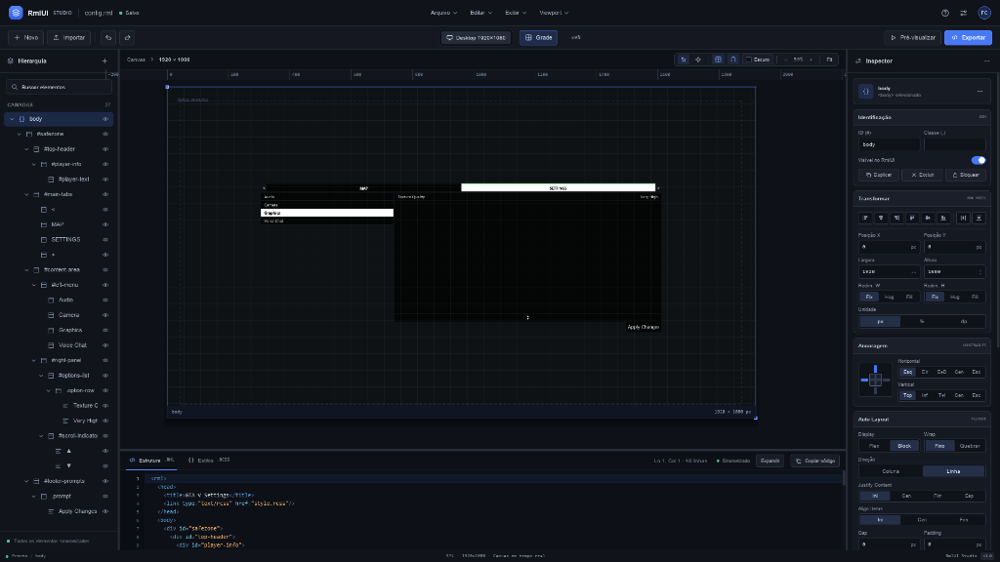

# RmlUI Studio

> 🇺🇸 **English** | 🇧🇷 [Português (Brasil)](README.pt-BR.md)

Visual UI editor for **RmlUi** (Figma-style), built with **C++17**, **RmlUi**, **FreeType**, and **DirectX 11** for Windows.



---

## How It Works

**RmlUI Studio** uses **RmlUi** itself both to render the user's document and to draw the editor's own interface on top of a native **DirectX 11** backend on Windows:

### 1. Dual-Context Architecture (`RmlEngineHost` — `src/rml_engine.h`)
- **Canvas Context (`CanvasContext`):** Renders the user's `.rml`/`.rcss` document into a GPU *RenderTarget* texture (`ID3D11ShaderResourceView`), enabling zoom, pan, direct element selection (real RmlUi DOM *hit-testing*), visual manipulation, and live interaction.
- **Editor Context (`EditorContext`):** Renders the entire studio interface (panels, layer tree, property inspector, and toolbar) directly to the *backbuffer* via RmlUi, with no ImGui dependency.

### 2. Document Model & RML/RCSS Generation (`RmlDocument` — `src/rml_doc.h`)
- **Node Tree (`RmlNode`):** Represents RmlUi elements (`div`, `button`, `input`, `span`, `img`, `progress`) with properties for:
  - **Geometry & Layout:** position, dimensions, *Flexbox* (`display: flex`, `flex-direction`, `justify-content`, `align-items`, `flex-wrap`, `gap`, `padding`), sizing modes (`Fixed`, `Hug`, `Fill`), anchors/constraints, and visual *Layout Grids* (columns, rows, or uniform grid).
  - **Appearance & Typography:** background color, borders, `border-radius`, opacity, text color/size/weight/alignment, and `:hover` states.
  - **Assets:** image support (``) with paths resolved relative to the project base directory.
- **Live Import & Synchronization:**
  - Imports existing `.rml` and `.rcss` files directly through the RmlUi DOM (`ImportRmlFile`, `ImportRcssAndSync`).
  - Applies `.rml` and `.rcss` code edits in real time on the canvas (`ApplyRmlStringAndSync`, `ApplyRcssStringAndSync`), with RCSS sanitization for RmlUi compatibility (`SanitizeRcssForRmlUi`).
  - Exports the project back to `.rml`, `.rcss`, and assets (`GenerateRmlAndRcss`, `ExportToPath`).

### 3. DirectX 11 Rendering & Icons (`Dx11Renderer2D` / `studio_icons`)
- **`src/dx11_renderer.h` / `.cpp`:** DirectX 11 2D backend (`d3d11`, `dxgi`, `d3dcompiler`, `windowscodecs`) responsible for displaying the canvas texture and drawing selection *overlays*, dashed outlines, and visual guides.
- **`src/studio_icons.h` / `.cpp`:** Generates premultiplied 32×32 RGBA vector icons directly in code, dynamically tinted by RmlUi via `image-color`.

---

## Project Structure

- `CMakeLists.txt` — CMake configuration (C++17, static FreeType, static RmlUi Core, and `RmlUIStudio` executable).
- `src/main.cpp` — Win32 window initialization, DirectX 11 device, *swap chain*, and main loop.
- `src/rml_doc.h` / `.cpp` — Document model, nodes, constraints, and `.rml`/`.rcss` import/export.
- `src/rml_engine.h` / `.cpp` — RmlUi integration (Canvas and Editor contexts, DOM, and DX11 texture rendering).
- `src/dx11_renderer.h` / `.cpp` — DirectX 11 2D renderer and texture management.
- `src/studio_ui.h` / `.cpp` — Studio UI logic, canvas interaction, panels, and inspector.
- `src/studio_icons.h` / `.cpp` — Code-generated vector icons.
- `third_party/RmlUi/` — RmlUi library (static subproject).
- `third_party/freetype/` — FreeType library (static font engine for RmlUi).

---

## Building (Windows)

### Prerequisites
- **Windows** (Win32 API & DirectX 11)
- **CMake** 3.20 or higher
- **C++17 compiler** (e.g., Visual Studio / MSVC) with Windows SDK

### Build
```sh
git clone --recursive https://github.com/<your-username>/RmlUI-Studio.git
cd RmlUI-Studio
cmake -B build
cmake --build build --config Release
```

---

## Credits & Libraries

This project uses the following libraries and APIs:

1. **RmlUi — The RmlUi Team & Contributors**
   - Copyright (c) 2008–2014 CodePoint Ltd, Shift Technology Ltd, and contributors
   - Copyright (c) 2019–2026 The RmlUi Team, and contributors
   - HTML/CSS-like UI engine used for both the canvas and the editor UI (`third_party/RmlUi/`).
   - License: **MIT** ([`third_party/RmlUi/LICENSE.txt`](third_party/RmlUi/LICENSE.txt)).

2. **FreeType 2 — The FreeType Project**
   - Font rasterization engine used by RmlUi (`third_party/freetype/`).
   - License: **FreeType License (FTL)** or **GPLv2** ([`third_party/freetype/LICENSE.TXT`](third_party/freetype/LICENSE.TXT); used under **FTL**).

3. **Microsoft Windows SDK / DirectX 11**
   - Windows system and graphics APIs used by the backend (`d3d11`, `dxgi`, `d3dcompiler`, `windowscodecs`, `dwmapi`, `comdlg32`, `ole32`, `user32`, `shell32`).
