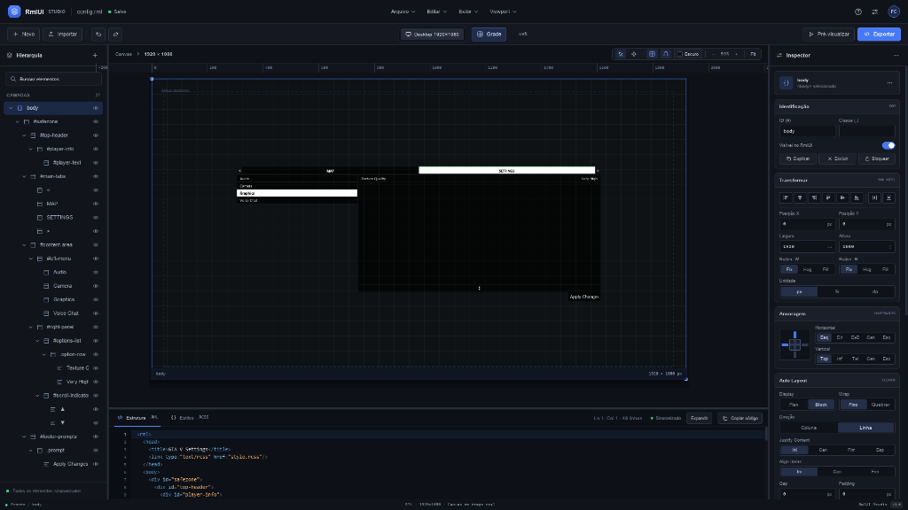

# RmlUI Studio

> 🇺🇸 [English](README.md) | 🇧🇷 **Português (Brasil)**

Editor visual de interfaces para **RmlUi** (estilo Figma), construído em **C++17**, **RmlUi**, **FreeType** e **DirectX 11** para Windows.



---

## Como o projeto funciona

O **RmlUI Studio** usa o próprio **RmlUi** tanto para renderizar o documento do usuário quanto para desenhar a interface do editor, sobre um backend **DirectX 11** nativo no Windows:

### 1. Arquitetura de Dois Contextos (`RmlEngineHost` — `src/rml_engine.h`)
- **Contexto do Canvas (`CanvasContext`):** Renderiza o documento `.rml`/`.rcss` do usuário em uma textura *RenderTarget* na GPU (`ID3D11ShaderResourceView`), permitindo zoom, pan, seleção direta de elementos (*hit-testing* no DOM real do RmlUi), manipulação visual e interação ao vivo.
- **Contexto do Editor (`EditorContext`):** Renderiza toda a interface do estúdio (painéis, árvore de camadas, inspetor de propriedades e barra de ferramentas) diretamente no *backbuffer* via RmlUi, sem dependência de ImGui.

### 2. Modelo de Documento e Geração de RML/RCSS (`RmlDocument` — `src/rml_doc.h`)
- **Árvore de nós (`RmlNode`):** Representa elementos RmlUi (`div`, `button`, `input`, `span`, `img`, `progress`) com propriedades de:
  - **Geometria e Layout:** posição, dimensões, *Flexbox* (`display: flex`, `flex-direction`, `justify-content`, `align-items`, `flex-wrap`, `gap`, `padding`), modos de dimensionamento (`Fixed`, `Hug`, `Fill`), âncoras/constraints e grades visuais (*Layout Grids*: colunas, linhas ou grade uniforme).
  - **Aparência e Tipografia:** cor de fundo, bordas, `border-radius`, opacidade, cor/tamanho/peso/alinhamento de texto e estados `:hover`.
  - **Assets:** suporte a imagens (``) com resolução relativa ao diretório base do projeto.
- **Importação e Sincronização ao Vivo:**
  - Importa arquivos `.rml` e `.rcss` existentes diretamente pelo DOM do RmlUi (`ImportRmlFile`, `ImportRcssAndSync`).
  - Aplica alterações de código `.rml` e `.rcss` em tempo real no canvas (`ApplyRmlStringAndSync`, `ApplyRcssStringAndSync`), com sanitização de RCSS para compatibilidade com o RmlUi (`SanitizeRcssForRmlUi`).
  - Exporta o projeto de volta para `.rml`, `.rcss` e assets (`GenerateRmlAndRcss`, `ExportToPath`).

### 3. Renderização DirectX 11 e Ícones (`Dx11Renderer2D` / `studio_icons`)
- **`src/dx11_renderer.h` / `.cpp`:** Backend 2D em DirectX 11 (`d3d11`, `dxgi`, `d3dcompiler`, `windowscodecs`) responsável por exibir a textura do canvas, desenhar *overlays* de seleção, contornos tracejados e guias visuais.
- **`src/studio_icons.h` / `.cpp`:** Gera ícones vetoriais 32×32 RGBA pré-multiplicados diretamente em código, coloridos dinamicamente pelo RmlUi via `image-color`.

---

## Estrutura Principal

- `CMakeLists.txt` — Configuração CMake (C++17, FreeType estático, RmlUi Core estático e executável `RmlUIStudio`).
- `src/main.cpp` — Inicialização da janela Win32, dispositivo DirectX 11, *swap chain* e loop principal.
- `src/rml_doc.h` / `.cpp` — Modelo de documento, nós, constraints, importação/exportação `.rml` e `.rcss`.
- `src/rml_engine.h` / `.cpp` — Integração com o RmlUi (contextos de Canvas e Editor, DOM e renderização em textura DX11).
- `src/dx11_renderer.h` / `.cpp` — Renderizador 2D DirectX 11 e gerenciamento de texturas.
- `src/studio_ui.h` / `.cpp` — Lógica da interface do estúdio, interação com canvas, painéis e inspetor.
- `src/studio_icons.h` / `.cpp` — Ícones vetoriais gerados em código.
- `third_party/RmlUi/` — Biblioteca RmlUi (subprojeto estático).
- `third_party/freetype/` — Biblioteca FreeType (motor de fontes estático para o RmlUi).

---

## Como Compilar (Windows)

### Pré-requisitos
- **Windows** (API Win32 e DirectX 11)
- **CMake** 3.20 ou superior
- **Compilador C++17** (ex.: Visual Studio / MSVC) com Windows SDK

### Build
```sh
git clone --recursive https://github.com/<seu-usuario>/RmlUI-Studio.git
cd RmlUI-Studio
cmake -B build
cmake --build build --config Release
```

---

## Créditos e Bibliotecas

Este projeto utiliza as seguintes bibliotecas e APIs:

1. **RmlUi — The RmlUi Team & Contribuidores**
   - Copyright (c) 2008–2014 CodePoint Ltd, Shift Technology Ltd, and contributors
   - Copyright (c) 2019–2026 The RmlUi Team, and contributors
   - Motor de interface HTML/CSS-like utilizado tanto no canvas quanto na UI do editor (`third_party/RmlUi/`).
   - Licença: **MIT** ([`third_party/RmlUi/LICENSE.txt`](third_party/RmlUi/LICENSE.txt)).

2. **FreeType 2 — The FreeType Project**
   - Motor de rasterização de fontes utilizado pelo RmlUi (`third_party/freetype/`).
   - Licença: **FreeType License (FTL)** ou **GPLv2** ([`third_party/freetype/LICENSE.TXT`](third_party/freetype/LICENSE.TXT); utilizado sob a **FTL**).

3. **Microsoft Windows SDK / DirectX 11**
   - APIs gráficas e de sistema do Windows utilizadas pelo backend (`d3d11`, `dxgi`, `d3dcompiler`, `windowscodecs`, `dwmapi`, `comdlg32`, `ole32`, `user32`, `shell32`).
